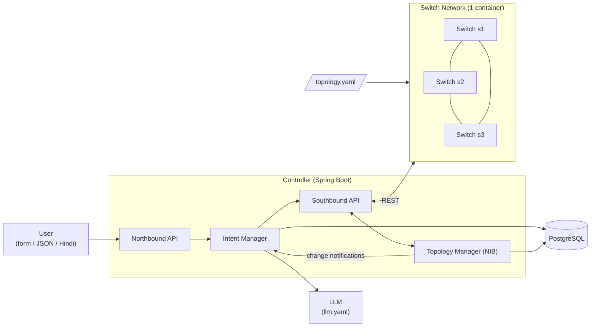
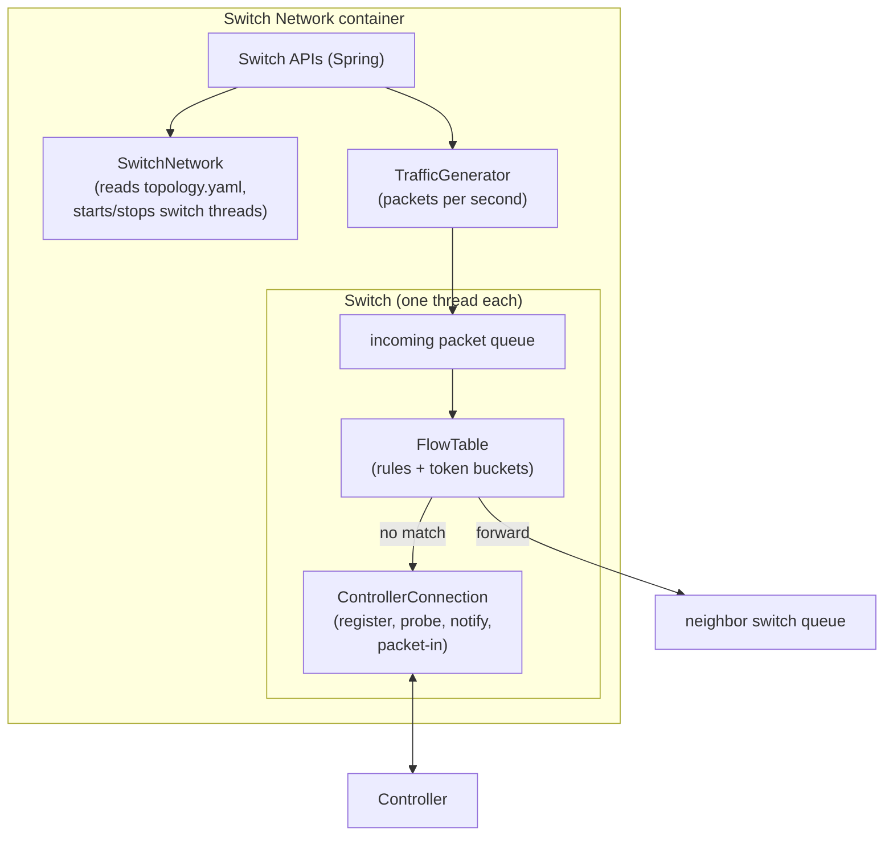
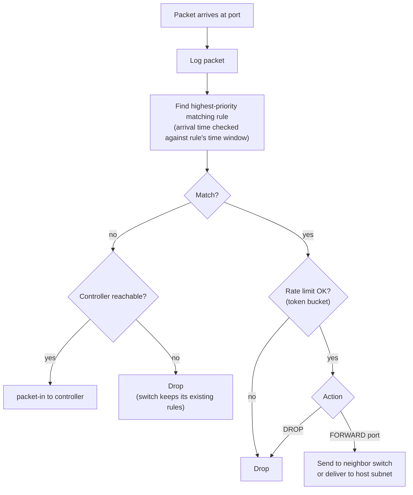
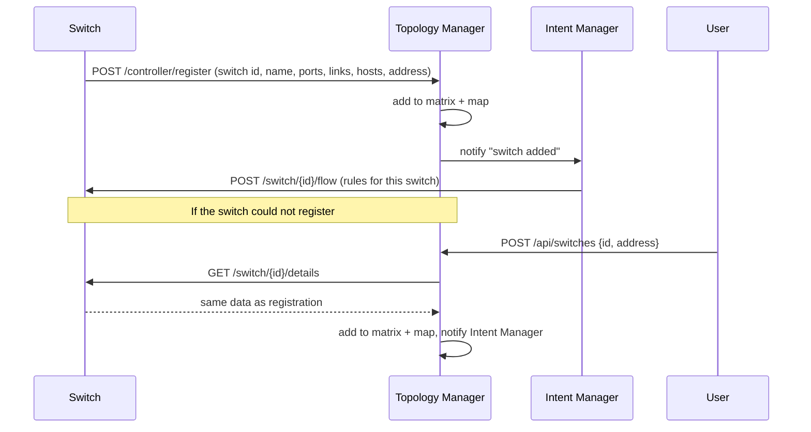
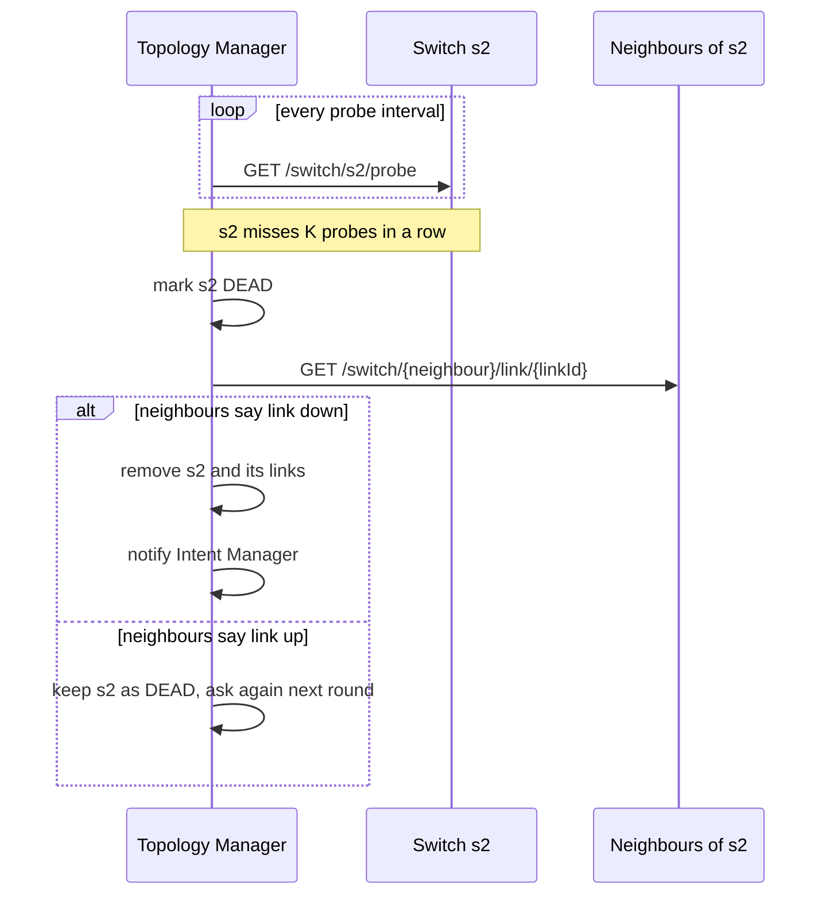
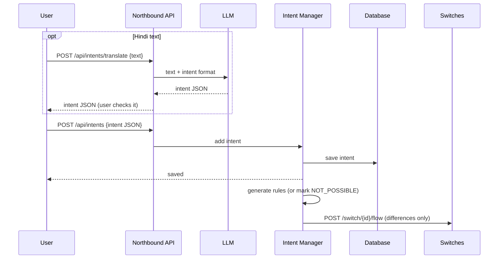
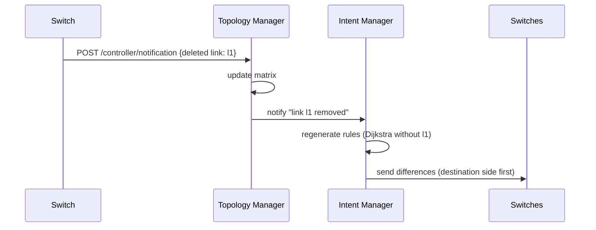
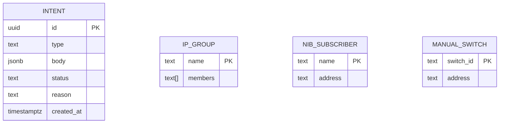
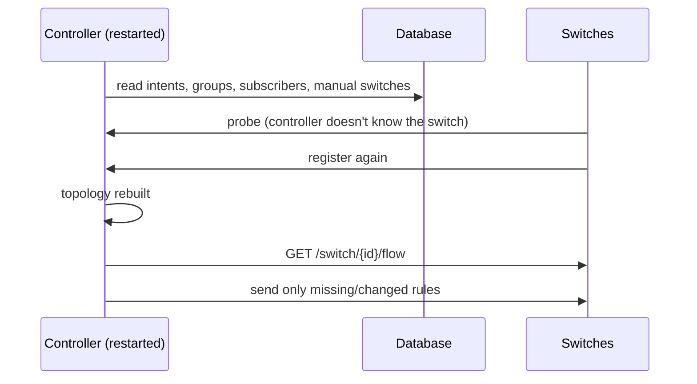

# Orion-Lite — Design

> Version 2.0 (simplified) · Java + Spring Boot (APIs only) · PostgreSQL

The system has **four components** that share **one database**:

1. **Switch Network**: one container, one thread per switch.
2. **Topology Manager (NIB)**: builds and maintains the topology. It is the single source of truth and publishes changes.
3. **Intent Manager**: stores intents, turns them into flow rules and writes them to the switches.
4. **Southbound and Northbound APIs**: REST endpoints between the switches and the controller (southbound) and between the user and the controller (northbound).

Components 2–4 run in one Spring Boot application (the **controller**). Each component is its own plain-Java class, so the monolith mirrors a microservice design. Spring is used only for the REST endpoints.

---

## 1. Overview



**Rules of the system**

- The **NIB's in-memory topology** is the single source of truth for the network.
- The **database** is the single source of truth for intents.
- Flow rules are always generated from those two: `flow rules = generate(intents, topology)`.

---

## 2. Topology file

One central file defines the switches, their links and the host subnets attached to them. The Switch Network reads it at startup, and every switch tells the controller its part when it registers.

```yaml
controller:
  url: http://controller:8181
  authToken: secret-token

switches:
  - id: s1
    name: edge-north
    ports: 4
    hosts:
      - { port: 4, subnet: 10.0.1.0/24 }   # host subnet on this port
  - id: s2
    name: core
    ports: 4
  - id: s3
    name: edge-south
    ports: 4
    hosts:
      - { port: 4, subnet: 10.0.3.0/24 }

links:
  - { id: l1, a: "s1:1", b: "s2:1", latencyMs: 5 }
  - { id: l2, a: "s2:2", b: "s3:1", latencyMs: 5 }
  - { id: l3, a: "s1:2", b: "s3:2", latencyMs: 20 }
```

- A **link** is a wire between two switch ports, so each switch already knows its links.
- **Host subnets** tell the controller where each IP lives. Without them it could not route to an IP or apply an intent such as "block 10.0.1.5".
- `latencyMs` is the link's travel time. Dijkstra and latency intents use it.

---

## 3. Component 1 — Switch Network

### 3.1 Structure



| Class | Job |
|---|---|
| `SwitchNetwork` | Reads the topology file, creates one `Switch` thread per switch and wires the links. Adds or drops switches and links at runtime. |
| `Switch` | Thread loop: take a packet, **log it**, match it against the flow table, then forward, drop or send it to the controller. |
| `FlowTable` | Holds the flow rules sorted by priority, with one token bucket for each rate-limited rule. |
| `ControllerConnection` | Registers with the controller, answers and sends probes, reports link changes and sends packet-ins. |
| `TrafficGenerator` | Creates packets at a port at a given packets-per-second rate. |

### 3.2 Packet handling



If the controller goes down, switches **keep forwarding with the rules they already have**.

### 3.3 Switch Network APIs (runtime control)

| Method | Path | Purpose |
|---|---|---|
| POST | `/network/switches` | Add a switch |
| DELETE | `/network/switches/{id}` | Drop a switch |
| POST | `/network/links` | Add a link `{id, a: "s1:3", b: "s4:1", latencyMs}` |
| DELETE | `/network/links/{id}` | Drop a link |
| POST | `/switch/{id}/send` | Send packets into this switch at a port (below) |

Send-packet request:

```json
{
  "inPort": 4,
  "srcIp": "10.0.1.5",  "srcPort": 51000,
  "dstIp": "10.0.3.7",  "dstPort": 22,
  "l2Protocol": "ETHERNET", "l3Protocol": "IPV4",
  "l4Protocol": "TCP",      "appProtocol": "SSH",
  "sizeBytes": 512,
  "packetsPerSecond": 50,
  "durationSec": 10
}
```

---

## 4. Flow rules

A flow rule is **match + action + priority**.

```json
{
  "ruleId": "r-17",
  "priority": 500,
  "match": {
    "srcIp": "10.0.1.0/24", "dstIp": "10.0.3.0/24",
    "srcPort": null, "dstPort": 22,
    "l2Protocol": null, "l3Protocol": "IPV4", "l4Protocol": "TCP", "appProtocol": null,
    "minSize": null, "maxSize": null,
    "inPort": null,
    "timeWindow": { "from": "09:00", "to": "18:00", "until": "2026-12-31T00:00:00Z" }
  },
  "action": { "type": "FORWARD", "port": 2 },
  "rateLimit": { "packetsPerSecond": 100 },
  "intentId": "…"
}
```

- **Match fields:** source/destination IP, source/destination port, packet size, protocol at each layer (data link, network, transport, application), incoming port and arrival time (`timeWindow`). A `null` field matches anything.
- **Actions:** `FORWARD(port)` or `DROP`.
- **Rate limit (optional):** a token bucket for packets that match the rule. Packets over the limit are dropped.
- **No match:** the packet goes to the controller (packet-in).
- **Priority:** two rules on a switch never share a priority, so a packet always matches exactly one rule. Drop rules get higher numbers than forward rules.

---

## 5. Component 2 — Topology Manager (NIB)

### 5.1 What it holds (in memory)

| Data | Form |
|---|---|
| Topology graph | **Adjacency matrix**: cell `[i][j]` holds the direct link between switch *i* and switch *j* (link id, ports on both sides, latency, up/down), or empty |
| Per-switch details | **Map** `switchId → {name, address, ports, host subnets, status, last seen}` |

### 5.2 What it does

- **Registration.** A switch registers when it starts. If a switch can't reach the controller, the user adds it through the API and the controller contacts the switch itself.
- **Link changes.** It applies link add/delete notifications sent by switches.
- **Probing.** Every *N* seconds it probes each switch. After *K* missed probes the switch is marked **DEAD**, and the controller asks its neighbours about the link to it:
  - neighbours say the link is **up** → the switch stays in the topology as **DEAD**, and the controller keeps asking each round;
  - neighbours say the link is **down** → the switch and its links are **removed**.
- **Pub/sub.** Every change is first applied to the topology, then a notification goes to each subscriber. Subscriber addresses are stored in the DB. The Intent Manager is the subscriber.

Because only the NIB changes the topology, and it notifies subscribers *after* applying each change, there are no data races.

### 5.3 Switch registration



### 5.4 Probing and dead switches



The switch also probes the controller. If the controller doesn't know it (for example after a controller restart), the switch registers again.

---

## 6. Component 3 — Intent Manager

### 6.1 Intents a user can give

| Intent | Example |
|---|---|
| `AVOID_LINK` | Do not use link l3 |
| `MAX_LATENCY` | Traffic from A to B must arrive in under 10 ms |
| `ISOLATE_GROUPS` | Group "guests" must never reach group "servers" |
| `BLOCK_TRAFFIC` | Block traffic from/to an IP, port or website |
| `BLOCK_PROTOCOL` | Block a kind of traffic (e.g. SSH, UDP) |
| `RATE_LIMIT` | Limit 10.0.1.5 to 100 packets per second |
| Time-bound | Any of the above, active only within a time window |

Intent format (the same format is used by the form, the JSON API and the LLM output):

```json
{
  "type": "BLOCK_PROTOCOL",
  "src": "group:guests",
  "dst": "10.0.3.0/24",
  "protocol": "SSH",
  "params": {},
  "timeWindow": { "from": "09:00", "to": "18:00", "until": null }
}
```

### 6.2 Turning intents into flow rules

**Default (no intent):** every packet takes the shortest path (Dijkstra on link latency) to the switch that owns its destination subnet. Each switch gets one forward rule per destination subnet.

| Intent | Flow rules generated |
|---|---|
| `AVOID_LINK` | Remove the link from a copy of the graph, rerun Dijkstra, update the forward rules |
| `MAX_LATENCY` | Dijkstra from A to B. If the path takes longer than *t*, the intent is **not possible**. Otherwise add forward rules along the path |
| `ISOLATE_GROUPS` | DROP rule (`src` = group A, `dst` = group B) on the switches where group A's subnets attach |
| `BLOCK_TRAFFIC` / `BLOCK_PROTOCOL` | DROP rule with the given match fields, on the switch(es) where the traffic enters |
| `RATE_LIMIT` | Forward rule with a token-bucket limit, on the switch where the traffic enters |
| Time-bound | Same rules with `timeWindow` set; switches compare each packet's arrival time with it |

**Not-possible check:** if an intent can't be applied (unknown IP or group, no path left, latency can't be met), it is stored with status `NOT_POSSIBLE` and the user is told why. It is checked again whenever the topology changes.

### 6.3 When rules are regenerated

The Intent Manager regenerates **all** rules, compares them with what each switch has, and sends only the differences:

- on startup, after reading the intents from the DB;
- when the user adds or removes an intent;
- when the NIB notifies it of a topology change;
- periodically, as a safety check: it fetches the topology and looks for a difference it missed.

**Consistency (simple):** when a path changes, the new rules go to the switch nearest the destination first and to the switch nearest the source last. Old rules are deleted only after that. No switch ever forwards onto a path that isn't ready.

### 6.4 Adding an intent (form or Hindi)



The LLM only turns text into the intent format. Flow rules are always generated by our own code, never by the LLM. The provider, model and key are set in `llm.yaml`.

### 6.5 Link change



---

## 7. Component 4 — APIs

All southbound calls carry an auth header.

**Southbound — on the controller (switch → controller)**

| Method | Path | Body |
|---|---|---|
| POST | `/controller/register` | `{switchName, switchId, switchIp, ports: [{port, linkId, peerSwitch, peerPort, latencyMs, hostSubnet}]}` |
| POST | `/controller/notification` | `{switchId, addedLink, deletedLink}` |
| POST | `/controller/packet-in` | `{switchId, inPort, packet}` |
| POST | `/controller/probe` | `{switchId}`; the switch checks the controller is alive |

**Southbound — on each switch (controller → switch)**

| Method | Path | Body |
|---|---|---|
| GET | `/switch/{id}/details` | — returns the same body as register |
| GET | `/switch/{id}/probe` | — |
| GET | `/switch/{id}/link/{linkId}` | — returns `{up: true/false}` |
| POST | `/switch/{id}/packet-out` | `{packet, outPort}` |
| POST | `/switch/{id}/flow` | `{add: [...], modify: [...], delete: [...]}`: one rule or many |
| GET | `/switch/{id}/flow` | — returns the current rules |

**Northbound (user → controller)**

| Method | Path | Purpose |
|---|---|---|
| POST | `/api/intents` | Add an intent |
| GET | `/api/intents` | List intents with status |
| DELETE | `/api/intents/{id}` | Remove an intent |
| POST | `/api/intents/translate` | Hindi/English text → intent JSON |
| GET / POST / DELETE | `/api/groups` | Manage IP groups |
| GET | `/api/topology` | Current topology |
| POST | `/api/switches` | Add a switch that couldn't register |

---

## 8. Database



| Table | Why |
|---|---|
| `intent` | Every intent; `status` is `ACTIVE`, `NOT_POSSIBLE` or `EXPIRED` |
| `ip_group` | Named groups of IPs/subnets used by intents |
| `nib_subscriber` | Who the NIB sends change notifications to |
| `manual_switch` | Switches added through the API, so the controller can reach them again after a restart |

The topology and flow rules are **not** stored. They are rebuilt from the switches and the intents.

---

## 9. Recovery on restart



| What restarts | What happens |
|---|---|
| Controller | Switches keep forwarding with their existing rules. They register again, the topology is rebuilt and rules are re-checked. |
| Switch Network | Switches start with empty flow tables, register, and get all their rules again. |
| Database | Comes back with its stored data; the controller reconnects. |

---

## 10. Config and code layout

```
backend/
├── shared/            packet, flow rule, switch↔controller messages
├── switch-network/    network/, processing/, communication/
├── sdn-controller/    communication/ (southbound, northbound), topology/, intent/, flowrules/, storage/
└── system-test/       end-to-end check
frontend/src/          topology/, sidebar/
```

`llm.yaml`:

```yaml
provider: anthropic        # or openai-compatible
model: claude-sonnet-5-5
baseUrl: https://api.anthropic.com
apiKeyEnv: ORION_LLM_API_KEY
```

---

## 11. Implementation notes (as built)

Decisions made during implementation, beyond sections 1–10:

| Topic | As built |
|---|---|
| Baseline routing | "Least effort" = **fewest hops** (latency breaks ties). `MAX_LATENCY` uses lowest latency, so the two can choose different paths (in the sample topology: baseline s1→s3 direct, latency intent s1→s2→s3). |
| Priorities | Unique per switch. Simple ordering: DROP > RATE_LIMIT > PATH > BASELINE, then more specific destination first. |
| Rate limit | One token bucket per intent per switch (shared by that intent's rules). |
| Time windows | Carried in the rule; the switch compares the packet's arrival time. `AVOID_LINK` windows are applied by the controller (re-checked every safety check). Expired intents become `EXPIRED`. |
| Dead switch kept | A `DEAD` switch stays in the topology but is not used for new paths. The switch network can simulate this with "cut control channel" (the switch keeps forwarding but ignores the controller). |
| Consistency | Rules are pushed in rounds by distance to the destination (destination side first, DROP rules first), and old rules are deleted last. |
| Restart safety | After a controller restart, the Intent Manager waits 8 s before its first computation so switches can re-register; pushes that fail are retried after 2 s. |
| Loops | Packets carry a TTL (64), decremented per hop. |
| UI | React (Vite) served by nginx on port 3000. nginx proxies `/ctrl` → controller and `/net` → switch network. |
| Ports | Controller 8181, switch network 9191, UI 3000, Postgres 5433 (all changeable with environment variables). |
| LLM | `provider: anthropic` uses the official Anthropic Java SDK (default model `claude-opus-5-5`, server-side refusal fallback on); `openai-compatible` uses plain HTTP. |

Extra endpoints added for the UI and testing:

- Switch network: `GET /network/logs`, `GET/DELETE /network/traffic`, `PATCH /network/switches/{id}` (cut control), `PATCH /network/links/{id}` (down/up).
- Controller: `GET /api/events`, `GET /api/status`, `GET /api/switches/{id}/flows`, `POST /api/recompute`, `GET/POST/DELETE /api/subscribers`, `GET /api/llm`.
